# PET HORIZON — P4 INTERNAL LINKING ARCHITECTURE & TOPICAL AUTHORITY

**Target Domain:** `https://pethorizon.jawumitech.com`  
**Audit Execution Date:** November 6, 2026  
**Auditor:** Pet Horizon Architecture Desk  
**Status:** Implemented & Verified in Local Repository

---

## 1. Topical Authority & The Topic Cluster Model

Search engines reward websites that demonstrate deep, structured expertise through coherent **Hub-and-Spoke (Topic Cluster)** internal linking. Rather than isolated blog posts competing for rankings, Pet Horizon organizes its 39 articles and 2 interactive tools into 5 interconnected clusters anchored by high-authority pillar pages:

```mermaid
graph TD
  A[PetHorizon Knowledge Graph] --> B[Cluster 1: Feeding & Nutrition]
  A --> C[Cluster 2: Health & Preventive Care]
  A --> D[Cluster 3: Family Hub & Daily Routine]
  A --> E[Cluster 4: Dog Care & Behavior]
  A --> F[Cluster 5: Cat Care & Feline Health]

  B --> B1[Pillar: Dog Feeding Schedule]
  B1 --> B2[Tool: Pet Calorie Calculator]
  B1 --> B3[Article: Toxic Foods]
  B1 --> B4[Article: Diabetes Insulin Timing]
  B1 --> B5[Article: Cat Feeding Schedule]

  C --> C1[Pillar: Vaccination Schedule]
  C1 --> C2[Article: Pet Health Records Tracker]
  C1 --> C3[Article: Pet Microchip Registration Guide]
  C1 --> C4[Article: NYC Vaccination Schedule]
  C1 --> C5[Article: Emergency Vet Red Flags]

  D --> D1[Pillar: Household Co-Parenting Sync]
  D1 --> D2[Article: Best Pet Care Apps 2026]
  D1 --> D3[Article: Pet Sitter Instructions Template]
  D1 --> D4[Article: London Co-Parenting Guide]
  D1 --> D5[Article: Multi-Pet Management]

  E --> E1[Pillar: New Puppy Checklist & Budget]
  E1 --> E2[Tool: Pet Age Calculator]
  E1 --> E3[Article: Puppy Potty Training]
  E1 --> E4[Article: Separation Anxiety Desensitization]
  E1 --> E5[Article: Rescue Dog 3-3-3 Rule]

  F --> F1[Pillar: Feline Kidney Disease]
  F1 --> F2[Article: Cat Feeding Enrichment]
  F1 --> F3[Article: Senior Cat Health Guide]
  F1 --> F4[Article: Kitten Introduction Guide]
  F1 --> F5[Article: Cat Litter Box Problems]
```

---

## 2. Weakly Linked Nodes & Resolution Matrix

During the baseline audit, 5 articles and 1 guide were identified as having weak connectivity (only 1 inbound internal link or minimal outbound links). During Phase 4, contextual inbound links were implemented and verified across the codebase:

| Article Slug | Baseline Inbound | P4 Inbound | Source Articles Adding Contextual Inbound Links | Rationale & User Flow |
| :--- | :--- | :--- | :--- | :--- |
| `pet-microchip-registration-lookup-guide` | 7 in / 1 out | **7 in / 4 out** | Outbound links added to `new-puppy-checklist`, `pet-health-records`, and `pet-travel-checklist`. | Connects microchip identification directly to new puppy preparation, international health passports, and the digital health card. |
| `rescue-dog-3-3-3-rule-decompression-routine-guide` | 1 in | **2 in** | Added inbound link from `multiple-pet-management-multi-dog-cat-household-routines`. | Pet owners adding an adopted shelter dog into a multi-pet home learn structured decompression milestones before pack integration. |
| `puppy-kitten-vaccination-schedule-booster-guide-new-york` | 1 in | **2 in** | Added inbound link from `pet-health-records-medication-schedule-tracker`. | Pet parents tracking municipal pet licensing and rabies compliance can directly reference NYC-specific health codes. |
| `household-pet-coparenting-feeding-routine-sync-london` | 1 in | **2 in** | Added inbound link from `best-pet-care-apps-medication-reminders-family-sync`. | Urban pet owners researching mobile coordination apps are guided to real-world London co-parenting synchronization. |
| `monthly-pet-care-cost-vet-expense-budget-toronto` | 1 in | **2 in** | Added inbound link from `pet-insurance-vs-savings-fund-vet-cost-guide`. | Canadian owners evaluating insurance deductibles gain localized CAD veterinary fee benchmarks in Toronto. |
| `best-pet-gps-trackers-health-wearables-review-sydney` | 1 in | **2 in** | Added inbound link from `dog-walking-schedule-by-age-breed-exercise-guide`. | High-energy working dog owners monitoring outdoor distance gain coastal field test benchmarks. |

**Result:** Zero orphan or weakly linked articles remain in the Pet Horizon catalog ($\text{Articles with } \le 1 \text{ inbound links} = 0$).

---

## 3. High-Value Interactive Calculator Funneling

Interactive tools serve as high-converting conversion engines that also signal massive topical authority to search engines. Pet Horizon routes traffic naturally into both tools:

### A. Pet Calorie & Daily Food Portion Calculator (`/tools/pet-calorie-calculator`)
- **Incoming In-Article Links:** 14 high-authority context links.
- **Key Inbound Gateways:**
  - `dog-feeding-schedule-by-age-puppy-to-adult` (calculate puppy to adult RER)
  - `pet-calorie-calculator-feeding-guide-apop` (companion clinical guide)
  - `cat-feeding-schedule-indoor-enrichment-guide` (calculate feline moisture & kcal targets)
  - `dog-cat-diabetes-insulin-feeding-schedule-guide` (precision meal portions for diabetic pets)
  - `multiple-pet-management-multi-dog-cat-household-routines` (prevent cross-feeding obesity)
  - `senior-dog-care-mobility-nutrition-routine-guide` (calculate geriatric metabolic drop)

### B. Pet Age in Human Years Calculator (`/tools/pet-age-calculator`)
- **Incoming In-Article Links:** 18 high-authority context links.
- **Key Inbound Gateways:**
  - `new-puppy-checklist-first-year-budget-guide` (biological development tracking)
  - `senior-dog-care-mobility-nutrition-routine-guide` (arthritis & senior life-stage threshold)
  - `senior-cat-care-health-diet-comfort-guide` (feline geriatric milestones)
  - `dog-walking-schedule-by-age-breed-exercise-guide` (epiphyseal growth plate closure timing)
  - `pet-insurance-vs-savings-fund-vet-cost-guide` (senior insurance premium escalations)

---

## 4. Anchor Text Diversity Guidelines

To prevent search engine algorithmic over-optimization penalties:
1. **Never use repetitive exact-match anchors:** Rotate anchor phrasing naturally across articles.
   - *Example:* Instead of repeating `"pet calorie calculator"` 14 times, alternate with `"calculate exact Resting Energy Requirements"`, `"WSAVA portion calculator"`, and `"compute your pet's daily calorie targets"`.
2. **Context-Rich Phrasing:** Anchor text should clearly describe the destination page's content rather than using generic labels like `"click here"` or `"learn more"`.
3. **No Sitewide Header/Footer Keyword Spam:** Core navigation remains sleek and minimalist, letting contextual in-article links pass organic relevance.

