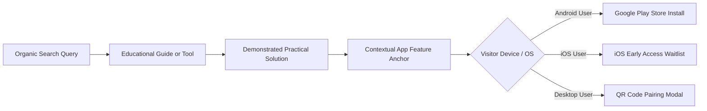

# PET HORIZON — P4 ORGANIC SEARCH CONVERSION & GA4 TELEMETRY AUDIT

**Target Domain:** `https://pethorizon.jawumitech.com`  
**Audit Execution Date:** November 6, 2026  
**Auditor:** Pet Horizon Analytics & Conversion Desk  
**Measurement ID:** `G-FHBNRZ7X6T`  
**Implementation File:** [`src/utils/analytics.ts`](file:///d:/Web/PetHorizon/PetHorizon_Web/src/utils/analytics.ts)

---

## 1. The Organic Visitor Conversion Journey

Pet Horizon transforms organic search visitors into loyal app users by pairing high-intent educational content with contextual mobile app utilities:

### The 4 High-Conversion Touchpoints:
1. **Interactive Calculator Completion:** Once a user calculates their pet's exact daily caloric portion or human age, a contextual card prompts them to synchronize the calculation with their PetHorizon daily feeding reminder timeline.
2. **End-of-Article Caregiver CTA:** At the conclusion of every article, a dedicated card provides direct Google Play download and iOS waitlist access tailored to the article's topic (e.g. "Save Your Pet's Microchip Passport in PetHorizon").
3. **Sticky Desktop Navigation & Mobile Header:** A high-contrast "Get App" / "Join iOS Waitlist" button remains accessible across the entire browsing journey.
4. **QR Code Pairing Modal (`QrDownloadModal.tsx`):** Desktop visitors clicking "Get on Google Play" receive an instant QR code scan interface allowing them to open the Google Play Store on their mobile device without typing.

---

## 2. GA4 Telemetry Architecture & Event Specifications

Telemetry is governed by `src/utils/analytics.ts`. All events are strictly typed in TypeScript and queued safely via `window.dataLayer` even if Google Tag Manager (`gtag.js`) is still executing its deferred load.

| Event Name | Trigger Condition | Primary Parameters | Attribution & Business Meaning |
| :--- | :--- | :--- | :--- |
| `play_store_click` | User clicks an Android download button, badge, or modal link. | `button_location` (`hero`, `nav`, `blog_detail`, `calculator_cta`), `page_path` | **Primary Business Conversion:** Outbound click leading to Google Play Store listing. |
| `ios_waitlist_signup` | User successfully submits their email in the iOS Waitlist modal. | `page_path`, `button_location` | **Secondary Business Conversion:** Lead capture for upcoming iOS launch. |
| `calculator_start` | User interacts with species, weight, age, or activity inputs. | `tool_name` (`pet_calorie_calculator`, `pet_age_calculator`), `species` | Engagement micro-conversion indicating tool adoption. |
| `calculator_complete` | User generates an output portion or biological age conversion. | `tool_name`, `species`, `calculated_rer_mer`, `human_age_result` | Successful calculation indicating high organic task completion. |
| `blog_read_engagement` | User scrolls past 50% of article body or interacts with figures. | `blog_slug`, `category`, `read_time` | Content consumption and reading depth metric. |

---

## 3. Privacy, PII Protection & Duplicate Event Prevention

1. **Strict PII Protection:**
   - Under no circumstances is user personally identifiable information (such as email addresses, telephone numbers, or pet names) passed into GA4 event parameters.
   - During `ios_waitlist_signup`, the email address is submitted securely to the private waitlist backend; GA4 receives only the generic completion event `ios_waitlist_signup` with `page_path`.
2. **Duplicate Firing Safeguards:**
   - In `PetCalorieCalculator.tsx` and `PetAgeCalculator.tsx`, calculation completion telemetry is debounced to prevent flooding GA4 when users adjust slider weights rapidly.
   - Outbound link tracking uses direct event handlers that execute prior to external navigation without double-firing on click/tap events.
3. **No Fabricated Installs Distinction:**
   - We maintain a strict boundary between `play_store_click` (outbound interest measured by Pet Horizon web) and verified App Installs (measured exclusively via Google Play Console attribution).

---

## 4. Mobile & Desktop Conversion Usability Audit

| Screen & Control | Usability Benchmark | Verified Implementation |
| :--- | :--- | :--- |
| **Mobile CTA Tap Targets** | Minimum $48 \times 48\text{ px}$ clickable area | All buttons adhere to minimum $48\text{ px}$ height with responsive padding. |
| **Desktop QR Modal** | Clear visual scan path with sharp SVG QR | Displays crisp QR code linking directly to Google Play package `com.anonymous.PetHorizon`. |
| **Kibble Density Input** | Transparency on volumetric vs metric feeding | Users can adjust kibble kcal/kg directly (defaults to standard $3,600\text{ kcal/kg}$) for precise gram weights. |
| **No Annoying Popups** | Non-intrusive SaaS presentation | Zero full-screen takeover popups or aggressive countdown timers that disrupt reader experience. |

